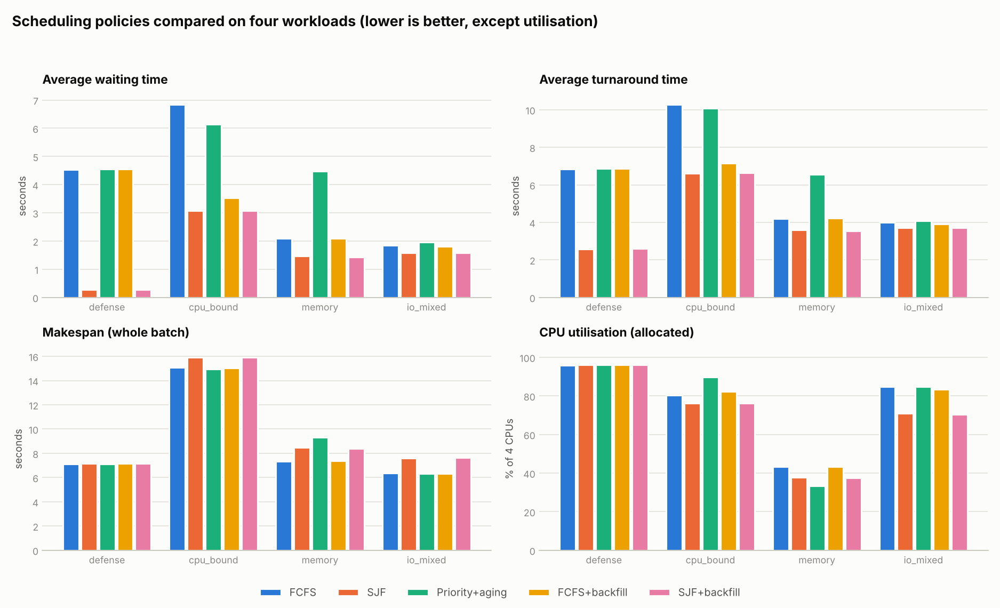
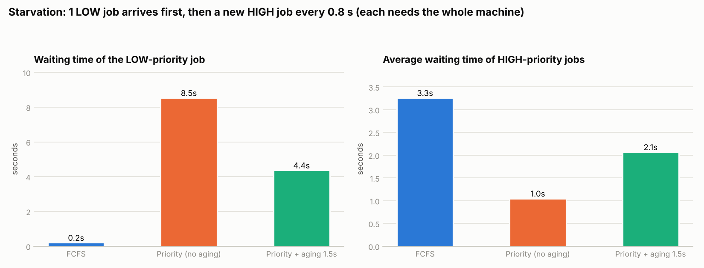
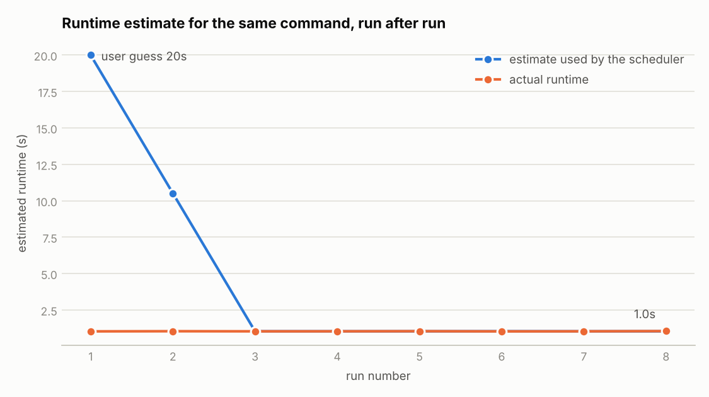

# Experiments

Every policy is run on the **same job sets** on a fresh scheduler daemon each time (own SQLite
database, nothing carried over). All jobs of a scenario are submitted while the scheduler is on `hold` and then
released together, so the policy sees the whole batch. Metrics are the scheduler's own accounting
(submit / start / end timestamps) plus `/proc` CPU time.

Reproduce: `make experiments` (≈4 min) → `experiments/results/{results.csv, results.json, summary.md, *.png}`.

## Setup

| | |
|---|---|
| Scheduler pool | 4 virtual CPUs, 4 GB RAM (`--cpus 4 --mem 4G`), `batch_window 0.1 s`, `tick 0.2 s` |
| Host used for the committed results | Linux 6.18 sandbox, **2 real CPU cores**, 8 GB RAM, Python 3.13 |
| Estimates | the user estimate equals the true duration (best case for SJF/backfill; see "Not tested") |
| Repetitions | **one run per cell** - differences below ~0.2 s on the logic-only scenario and below ~1 s on real-CPU scenarios are noise |
| Policy variants | FCFS · SJF · Priority (+aging 4 s) · FCFS+backfill · SJF+backfill |

| scenario | jobs (CPU / duration / declared RAM) | what it stresses |
|---|---|---|
| `defense` | A 4 CPU 6 s; B, C, D 1 CPU 1 s (the assignment's test, ÷10) | head-of-line blocking, average waiting time |
| `cpu_bound` | 6 real CPU-burning jobs, 1-4 workers, 1-4 s, mixed priorities | CPU contention (`cpu_bound.py`) |
| `memory` | 6 jobs, 800-3000 MB declared, 1-3 s, mixed priorities | **memory** (not CPU) as the bottleneck (`mem_bound.py`) |
| `io_mixed` | 7 file-I/O (write+fsync+read) and mixed jobs, 1-3 CPUs, 1-4 s | I/O and mixed behaviour (`io_bound.py`, `mixed.py`) |
| `starvation` | 1 LOW 4-CPU job at t=0, then a HIGH 4-CPU job every 0.8 s (8 jobs) | starvation and aging |
| `estimator` | the same command 8 times, user guess 20 s, truth ≈1 s | learning estimator |

## Results

### defense

| policy | avg wait (s) | avg turnaround (s) | makespan (s) | CPU util. alloc. | ETA error (s) |
|---|---:|---:|---:|---:|---:|
| FCFS | 4.54 | 6.84 | 7.12 | 96% | 0.03 |
| SJF | 0.27 **(best)** | 2.59 | 7.14 | 96% | 0.02 |
| Priority+aging | 4.55 | 6.86 | 7.14 | 96% | 0.05 |
| FCFS+backfill | 4.55 | 6.87 | 7.15 | 96% | 0.05 |
| SJF+backfill | 0.27 | 2.60 | 7.16 | 96% | 0.02 |

### cpu_bound

| policy | avg wait (s) | avg turnaround (s) | makespan (s) | CPU util. alloc. | ETA error (s) |
|---|---:|---:|---:|---:|---:|
| FCFS | 6.84 | 10.28 | 15.08 | 80% | 2.67 |
| SJF | 3.07 **(best)** | 6.61 | 15.91 | 76% | 1.40 |
| Priority+aging | 6.13 | 10.08 | 14.95 | 90% | 3.13 |
| FCFS+backfill | 3.52 | 7.15 | 15.02 | 82% | 2.35 |
| SJF+backfill | 3.08 | 6.64 | 15.92 | 76% | 1.41 |

### memory

| policy | avg wait (s) | avg turnaround (s) | makespan (s) | CPU util. alloc. | ETA error (s) |
|---|---:|---:|---:|---:|---:|
| FCFS | 2.09 | 4.20 | 7.33 | 43% | 0.08 |
| SJF | 1.47 | 3.61 | 8.46 | 38% | 0.13 |
| Priority+aging | 4.48 | 6.56 | 9.31 | 33% | 0.14 |
| FCFS+backfill | 2.09 | 4.22 | 7.37 | 43% | 0.09 |
| SJF+backfill | 1.44 **(best)** | 3.54 | 8.39 | 38% | 0.10 |

### io_mixed

| policy | avg wait (s) | avg turnaround (s) | makespan (s) | CPU util. alloc. | ETA error (s) |
|---|---:|---:|---:|---:|---:|
| FCFS | 1.86 | 3.99 | 6.35 | 85% | 0.14 |
| SJF | 1.58 **(best)** | 3.71 | 7.59 | 71% | 0.14 |
| Priority+aging | 1.96 | 4.10 | 6.34 | 85% | 0.10 |
| FCFS+backfill | 1.81 | 3.92 | 6.35 | 83% | 0.38 |
| SJF+backfill | 1.59 | 3.72 | 7.64 | 70% | 0.15 |

### starvation

| policy | LOW job wait (s) | HIGH jobs avg wait (s) | makespan (s) |
|---|---:|---:|---:|
| FCFS | 0.20 | 3.26 | 10.77 |
| Priority (no aging) | 8.53 | 1.05 | 10.58 |
| Priority + aging 1.5s | 4.37 | 2.07 | 10.58 |

### estimator (innovation feature)

| run | estimate used (s) | actual (s) | relative error |
|---:|---:|---:|---:|
| 1 | 20.00 | 1.04 | 1829% |
| 2 | 10.52 | 1.05 | 905% |
| 3 | 1.04 | 1.04 | 0% |
| 4 | 1.04 | 1.04 | 0% |
| 5 | 1.04 | 1.05 | 1% |
| 6 | 1.05 | 1.04 | 1% |
| 7 | 1.04 | 1.04 | 0% |
| 8 | 1.04 | 1.05 | 1% |

## Analysis

**1. Average waiting time: SJF wins, exactly as theory predicts.** In `defense`, FCFS makes B, C and D wait
for A: (0+6+6+6)/4 = 4.5 s expected, 4.54 s measured; SJF starts B, C, D together and A after 1 s: 0.25 s expected,
0.27 s measured. Makespan is identical (≈7.1 s) because the same work is done on the same CPUs - only the *order*
changed. SJF also gave the best waiting time in the other three scenarios (3.07 vs 6.84 s in `cpu_bound`).

**2. …but SJF is not free: it can hurt makespan and utilisation.** In `memory`, SJF's waiting time is better
(1.47 vs 2.09 s) but its makespan is worse (8.46 vs 7.33 s) and utilisation lower (38 vs 43 %); in `io_mixed` makespan
7.59 vs 6.35 s. The job timelines show why: SJF orders by *length*, not by *size*, so it pushes the longest and
biggest jobs to the end where they can no longer overlap. In `memory` the two memory hogs (2500 MB and 3000 MB,
2500+3000 > 4096) ran back-to-back at the end (2.3 → 5.4 → 8.5 s); under FCFS the 2500 MB job started at t=0 next to
other jobs. In `io_mixed` the longest job (4.3 s) started at 3.3 s and finished last, while FCFS started it at 1.1 s.
*Metrics disagree: which policy is "best" depends on whether you care about average latency or total throughput.*

**3. Backfilling.** FCFS+backfill roughly halves FCFS's waiting time in `cpu_bound` (6.84 → 3.52 s) without hurting
makespan (15.0 s), i.e. it gets most of SJF's latency benefit while keeping FCFS's packing (82 % vs 76 % utilisation
for SJF). In `defense`, `memory` and `io_mixed` it changed nothing measurable: there the head job was blocked only
for very short periods or no later job fit the gap. *Backfill added no cost in any scenario.* SJF+backfill ≈ SJF because
SJF's order already puts short jobs first, so there is little left to backfill.

**4. Priority + aging optimises the important jobs, not the average.** `Priority+aging` has the worst waiting time and
utilisation in `memory` (4.48 s, 33 %). The timeline shows head-of-line blocking in strict mode: the HIGH 1500 MB job
starts first; the second HIGH job needs 3000 MB (1500+3000 > 4096) and blocks the queue until the first one ends; once it
runs, the next job in priority order (NORMAL, 2500 MB) does not fit either, so even the 800 MB jobs that *would* fit wait.
(Priority + backfilling was not run; it would be the natural fix.) In `cpu_bound` the same policy reached the highest utilisation
(90 %), but that is luck of this job set: the 4-CPU HIGH job started on an empty machine, whereas under FCFS it had to wait
until the 2-CPU LOW job finished (5.5 s) with CPUs idle. Use priority when some jobs matter more, not to minimise averages.

**5. Starvation and aging (`starvation`).** Without aging, the LOW job waits **8.5 s** - until the HIGH stream is over -
while HIGH jobs wait only 1.05 s on average. With aging (1.5 s), the LOW job waits **4.4 s**; the price is that HIGH jobs
wait **2.07 s**. FCFS is fair to the LOW job (0.2 s) but gives HIGH jobs 3.3 s. Aging is a knob that trades class latency
against fairness. *A first version of this experiment submitted all jobs at once and aging had no effect (8.4 s vs 8.4 s):
all jobs age at the same rate, so their relative order never changes. Aging only helps when higher-ranked jobs keep arriving -
the scenario was redesigned as an arrival stream.*

**6. Estimator (innovation).** The same command with a 20 s guess and a true runtime of ≈1.04 s: the first run is scheduled
with 20 s (error 1829 %), the second with the mean of guess and history (10.5 s), from the third run on with ≈1.04 s
(error ≈0-1 %). Caveat: `sleep_job.py` is almost deterministic; real jobs are noisier, but EWMA also absorbs slow drifts.

**7. ETA.** `queue` predicts start times by replaying the planner. With accurate estimates and no CPU oversubscription
the mean absolute error was 0.02-0.05 s (`defense`), 0.08-0.14 s (`memory`, `io_mixed`; up to 0.38 s with
backfill). In `cpu_bound` it was 1.4-3.1 s because the sandbox has only 2 real cores for 4 virtual CPUs: wide jobs ran
about twice as long as their estimate. The ETA is only as good as the estimates - the reason for the estimator.

## Not tested / threats to validity

* One run per cell, no confidence intervals. The numbers are indicative; the *direction* of each effect is explained by
  the job timelines, not only by the averages.
* `cpu_bound` was produced on 2 real cores for a 4-CPU virtual pool (physical oversubscription). On a machine with ≥ 4
  cores the absolute numbers will differ - rerun `make experiments`.
* Policies were compared with **accurate** estimates. SJF and backfilling under wrong estimates (backfill can delay the
  head job when a backfilled job overruns) were not measured.
* Jobs are short (1-6 s), so scheduler latency (batch window, 0.2 s tick) is visible (~0.1-0.3 s).
* No Round Robin and no cgroup-based enforcement (see `docs/DESIGN.md`, section 14).
